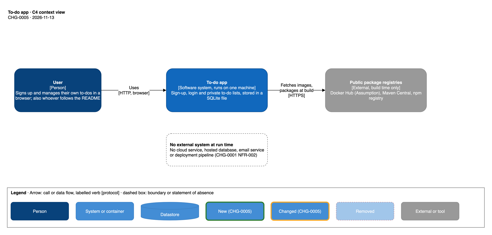
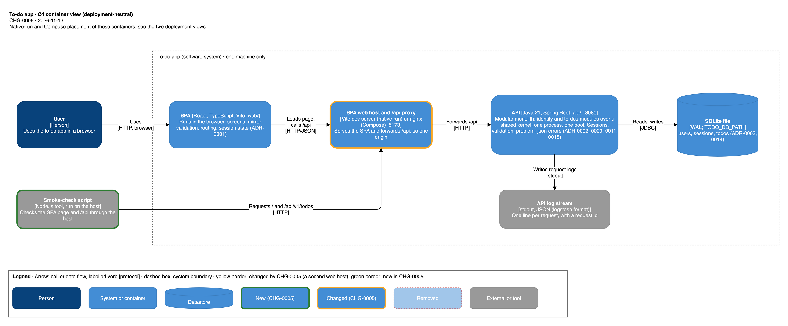
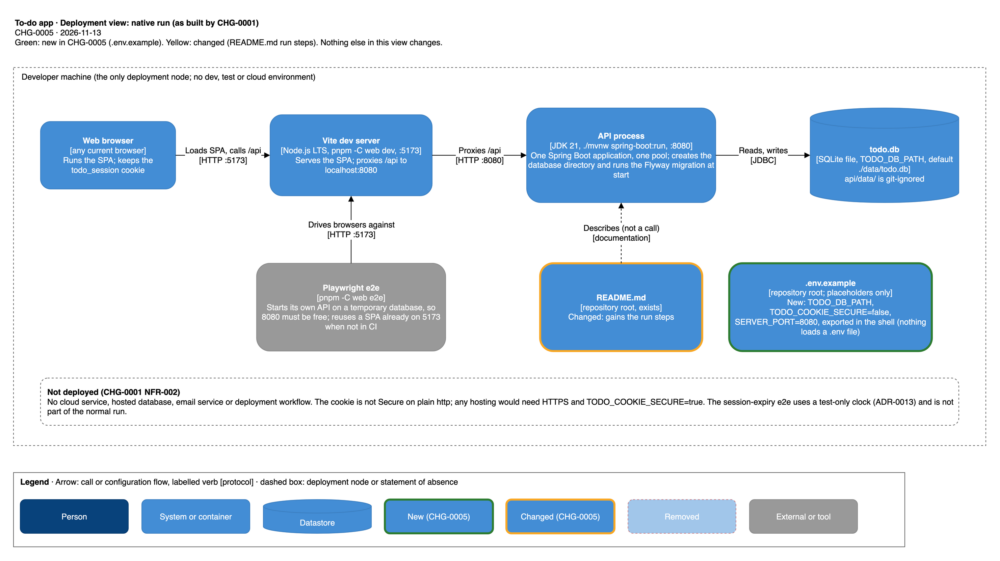
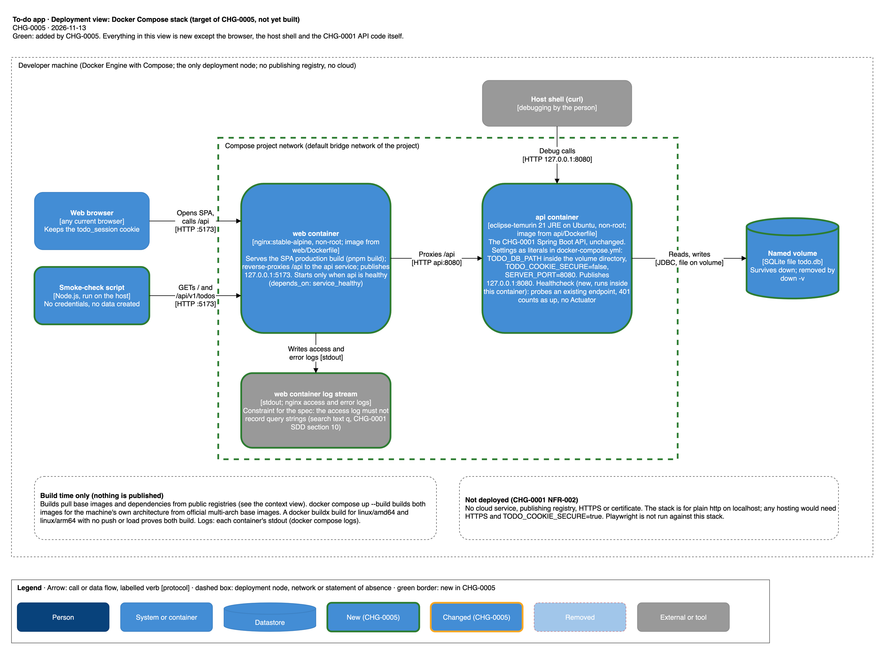

# To-do app — solution architecture

> The repository's one solution-architecture document. First version written by CHG-0005 (node N05-solution-arch). It
> describes the whole app as CHG-0001 built it (React SPA, Spring Boot API, SQLite) and the two ways of running it: the
> native run (merged) and the Docker Compose stack (what CHG-0005 adds, not yet built). Claims about existing code cite
> `path:Lstart-Lend`; assumptions are marked **Assumption:**. This change's additions are marked **[new]** and
> **[changed]**; nothing is **[removed]**. The CHG-0001 design (`docs/specs/CHG-0001/design/architecture/`) holds the
> component, sequence, data-model and screen-flow views; this document links to them and does not copy them.
>
> **This app is local-only.** CHG-0001 NFR-002 AC-2 forbids a cloud or hosted deployment, so no AWS or cloud
> deployment is drawn. Where the Well-Architected method expects a distributed treatment, each pillar below says what
> applies to a one-machine app, and every non-distributed choice is marked in section 8.

## 1. Context and scope

The app lets people sign up, log in and manage only their own to-dos through a web UI backed by an HTTP API, stored in
a SQLite file (`docs/specs/CHG-0001/sdd.md:L16-L31`). It runs on one machine. No external system exists at run time: no
cloud service, hosted database or email service (`docs/specs/CHG-0001/sdd.md:L41`, `L611`). Image builds (Compose) and
the native tool chain fetch base images and packages from public registries (Docker Hub, Maven Central, npm registry;
**Assumption:** Docker Hub for the official base images); the context view draws them as build-time externals. Out of scope: any cloud or
hosted deployment, `dev`/`test` environments, release automation, CI, registry publishing, HTTPS, Playwright against the
Compose stack (`docs/specs/CHG-0005/requirements.md:L303-L316`).

## 2. Quality goals, principles and non-functional requirements

**Quality goals**, most important first: (1) a person on a fresh checkout can run the app and use it
(CHG-0001 NFR-002 AC-1, completed by CHG-0005 REQ-DOC-001); (2) each user sees only their own data (REQ-ISO-001);
(3) data survives restarts (REQ-DATA-001, CHG-0005 NFR-105); (4) accessible UI (NFR-001); (5) local-only exposure
(NFR-002, CHG-0005 NFR-101).

**Principles.** The method's "distributed first" principle is not met by this app on purpose: it is one machine, one
API process, one SQLite file (see section 8 for each choice and its ADR). What it keeps from the principle: stateless
HTTP handling (the Spring Security chain is stateless, `api/src/main/java/app/todo/config/SecurityConfig.java:L52`; the
session lives in the database), module boundaries enforced by ArchUnit inside the one deployable (ADR-0018), and
request-correlated structured logs.

| NFR | Requirement | Measured by |
|---|---|---|
| CHG-0001 NFR-002 | local run, no cloud | e2e network spec; inspection (`docs/specs/CHG-0001/conformance.md:L153-L155`) |
| CHG-0001 NFR-003 | list and write results within 1 s at p95 with 500 to-dos | `web/e2e/performance.spec.ts` |
| CHG-0001 NFR-004, NFR-006 | input refused server-side; no internals shown | `docs/specs/CHG-0001/sdd.md:L796-L823` |
| CHG-0001 NFR-007 | modular monolith, one process, one pool | ArchUnit, endpoint-inventory test |
| CHG-0005 NFR-101 | published ports bound to 127.0.0.1 only | `docker compose ps` / `port` |
| CHG-0005 NFR-102 | no secrets in files | inspection |
| CHG-0005 NFR-103 | containers run as non-root | `id -u` in each container |
| CHG-0005 NFR-104 | images build for linux/amd64 and linux/arm64, nothing pushed | README buildx proof command |
| CHG-0005 NFR-105 | no to-do lost on `docker compose down` | person's UAT |
| CHG-0005 NFR-106 | API healthy within 120 s on a warm machine (proposed) | smoke-check run, compose status times |
| CHG-0005 NFR-107 | README commands and paths exist | inspection |

## 3. Containers and components

| Container | Technology | Responsibility | Owns | Calls |
|---|---|---|---|---|
| SPA | React, TypeScript, Vite; `web/` (`web/package.json:L21-L25`, `L42-L44`) | screens, mirror validation, routing, session state; the one fetch wrapper `web/src/api/client.ts` sends `X-Todo-Client: web` on unsafe methods (ADR-0007) | no data | `/api/v1/**` on its own origin |
| SPA web host and `/api` proxy **[changed]** | native run: Vite dev server on 5173 proxying `/api` to `http://localhost:8080` (`web/vite.config.ts:L5-L10`); Compose **[new]**: nginx serving the production build and proxying `/api` to the API container | one origin for page and API, so no CORS (ADR-0007) | nothing | API |
| API | Java 21, Spring Boot 4.1.2 (`api/pom.xml:L11-L16`, `L24`), one process, one pool | sign-up, login, sessions, validation (authoritative), to-do operations, problem+json errors, request logging | the SQLite file | SQLite (JDBC) |
| SQLite file | sqlite-jdbc 3.50.3.0 (`api/pom.xml:L52-L57`), WAL, one connection (`api/src/main/java/app/todo/config/DatabaseConfig.java:L22-L39`) | `users`, `sessions`, `todos`, `flyway_schema_history` | one owner: the API | — |
| API log stream | JSON (logstash format) to stdout (`api/src/main/resources/application.properties:L12`) | one line per request with request id; never bodies, cookies, hashes (`docs/specs/CHG-0001/sdd.md:L573-L577`) | — | — |
| Web host log stream **[new]** | Compose only: nginx access and error logs to stdout | host request log; must not record query strings (section 7.1, section 9) | — | — |
| Smoke-check script **[new]** | Node.js tool run on the host, outside the app's boundary (its path is the SDD's) | checks the SPA page and an unauthenticated `/api` call through the host | no data | web host |

**Components.** The API is a modular monolith: identity module `app.todo.auth`, to-dos module `app.todo.todo`, shared
kernel `app.todo.common`, composition root `app.todo.config` (`docs/specs/CHG-0001/sdd.md:L43-L73`; ADR-0018). Its
component views are `docs/specs/CHG-0001/design/architecture/c4-component-api.drawio` and `c4-component-errors.drawio`.
CHG-0005 changes none of them (it changes no code in `api/`, `docs/specs/CHG-0005/requirements.md:L311`). The SPA's
modules are listed in `docs/specs/CHG-0001/sdd.md:L98-L105`.

## 4. Integrations, contracts and key flows

No external integration exists. Internal interfaces, all synchronous:

| Interface | Protocol | Contract | On failure |
|---|---|---|---|
| browser to web host to API | HTTP/JSON on one origin, `/api/v1/**` | `docs/specs/CHG-0001/contracts/identity-api-v1.yaml`, `todo-api-v1.yaml`, `common-problem-v1.yaml` | every error is `application/problem+json` (`docs/specs/CHG-0001/sdd.md:L285-L303`); the SPA maps failures to friendly messages (sdd §6.1) |
| API to SQLite | JDBC, one pooled connection | `V1__init.sql` (`api/src/main/resources/db/migration/V1__init.sql`) | unexpected errors give a generic 500 and a logged stack trace |
| smoke-check **[new]** to web host | HTTP, unauthenticated GET of `/` and `/api/v1/todos` | 401 problem+json is the contract answer (`docs/specs/CHG-0001/contracts/common-problem-v1.yaml`, as cited at `docs/specs/CHG-0005/requirements.md:L226-L228`) | exits non-zero and says which request failed |
| compose healthcheck **[new]** to API | HTTP probe inside the API container on an existing endpoint; 401 counts as up | none (no new endpoint) | container reported unhealthy; web container waits |

**Key flows** (sequence views already exist: `seq-signup-login.drawio`, `seq-todo-crud-list.drawio`,
`seq-clear-completed.drawio` in the CHG-0001 design folder).

1. **Login.** The SPA posts credentials with `X-Todo-Client: web`; the API verifies the Argon2id hash, inserts a
   `sessions` row holding the SHA-256 of a random token and sets cookie `todo_session` (`HttpOnly`, `SameSite=Strict`,
   `Path=/`, `Max-Age` 8 h, `Secure` only when `TODO_COOKIE_SECURE=true`)
   (`api/src/main/java/app/todo/auth/AuthController.java:L40-L47`, `L61-L69`;
   `api/src/main/java/app/todo/auth/SessionService.java:L23`, `L35-L43`).
2. **Authenticated request.** `SessionCookieAuthenticationFilter` resolves the cookie to a `CurrentUser`; the to-dos
   module takes the owner only from it. Order of checks: session (401), client header (403), route, content type, body,
   validation, ownership (`docs/specs/CHG-0001/sdd.md:L174-L176`;
   `api/src/main/java/app/todo/config/SecurityConfig.java:L54-L60`;
   `api/src/main/java/app/todo/common/ClientHeaderFilter.java:L31-L41`).
3. **Compose start-up [new].** Compose builds both images; the API starts, creates the database file on the volume and
   runs its Flyway migration (ADR-0014); the healthcheck reports healthy; only then the web container starts and
   publishes 5173.
4. **Smoke check [new].** The script requests the SPA page (expects 200 HTML) and `GET /api/v1/todos` without a
   cookie through the proxy (expects 401 problem+json); a 200 HTML answer on `/api` fails it
   (`docs/specs/CHG-0005/requirements.md:L224-L231`).

## 5. Data and storage

One store: the SQLite file at `TODO_DB_PATH` (default `./data/todo.db`,
`api/src/main/java/app/todo/config/DatabaseConfig.java:L23`), owned by the API alone. Tables: `users` and `sessions`
(identity module), `todos` (to-dos module), `flyway_schema_history` (composition root); schema in
`docs/specs/CHG-0001/sdd.md:L107-L149`, view `docs/specs/CHG-0001/design/architecture/data-model.drawio`.

- **Consistency.** One pooled connection serialises access; WAL journal, foreign keys on, 5 s busy timeout
  (`DatabaseConfig.java:L33-L37`; ADR-0016). Last write wins on edits (ADR-0006).
- **Personal data.** Identifiers (user names or email addresses) and to-do text; passwords are stored only as Argon2id
  hashes, session tokens only as SHA-256 (ADR-0005, ADR-0004).
- **Native run.** The file is `api/data/todo.db` when the API is started from `api/`; `api/data/` is git-ignored
  (`api/.gitignore:L1-L2`). To wipe it, delete the file.
- **Compose [new].** The file lives on a named volume declared in `docker-compose.yml`, so it survives
  `docker compose down` and is removed by `docker compose down -v`.
- **Retention and backup.** Sessions are absolute 8 h (ADR-0008); expired rows are deleted when met
  (`SessionService.java:L52-L55`). No automatic backup or restore; a person may copy the file (native) or the volume
  (**Assumption:** copying a volume is outside this change).

## 6. Deployment and infrastructure

Environments: CHG-0001 NFR-002 AC-2 allows no `dev` or `test` deployment; the only environment is the person's own
machine, in one of two modes. A change moves to no other environment. No network zones beyond the machine: no ingress
from other hosts, no egress needed at run time. Build time is a trust boundary: image builds and the native tool chain
fetch base images and dependencies from public registries (see section 1; drawn in the context view).

### 6.1 Native run (as built by CHG-0001; documentation added by CHG-0005)

API: `cd api && ./mvnw spring-boot:run`, port 8080; SPA: `pnpm -C web install` then `pnpm -C web dev`, port 5173
(`docs/specs/CHG-0001/sdd.md:L603-L611`; `web/vite.config.ts:L5-L10`). Prerequisites: JDK 21, Node.js LTS (`web/.nvmrc:L1`
is `lts/*`), pnpm. Settings are `TODO_DB_PATH`, `TODO_COOKIE_SECURE`, `SERVER_PORT`
(`api/src/main/resources/application.properties:L3-L6`); nothing loads a `.env` file, the person exports them in the
shell (`docs/specs/CHG-0005/requirements.md:L77-L78`). **[changed]** `README.md` gains the run steps (it exists today as a
title only: `README.md:L1`; `docs/specs/CHG-0001/conformance.md:L153-L154`); **[new]** `.env.example`. The
Playwright e2e (`pnpm -C web e2e`) starts its own API on a temporary database and checks that port 8080 is free
(`web/e2e/support/api-process.ts:L33`; `web/e2e/support/launch.ts:L7-L8`, `L33-L42`); it starts the SPA on 5173 unless
one already runs there, which it reuses outside CI (`web/playwright.config.ts:L35-L42`).

### 6.2 Docker Compose stack (target of CHG-0005, **[new]**, not yet built)

- **web container [new]**: `nginx:stable-alpine`, non-root, image from `web/Dockerfile` (multi-stage: Node LTS and
  pnpm through corepack build the SPA with `pnpm build`). Serves the build and reverse-proxies `/api` to the api
  service, so the browser sees one origin and the `todo_session` cookie and `X-Todo-Client` header pass as in the
  native run. Client routes (for example the to-do list and login screens, `docs/specs/CHG-0001/adr/0001-react-typescript-spa.md:L16-L20`)
  must work on reload and direct entry, as they do under the Vite dev server, so every non-`/api` path that is not a
  file must answer `index.html` and `/api` must never do so (REQ-CMP-003 AC-3, REQ-CMP-002 AC-2; the nginx
  configuration is the spec author's, section 9). Writes access and error logs to stdout, which must not record query
  strings (section 7.1). Publishes `127.0.0.1:5173`. Starts after the API is healthy.
- **api container [new]**: image from `api/Dockerfile` (multi-stage: `eclipse-temurin` JDK 21 builds with `./mvnw`;
  `eclipse-temurin` JRE 21 on the Ubuntu variant runs it, not Alpine, because the SQLite driver ships native code),
  non-root. Publishes `127.0.0.1:8080` (for debugging). Settings as literal values in `docker-compose.yml`:
  `TODO_DB_PATH` inside the volume's directory, `TODO_COOKIE_SECURE=false`, `SERVER_PORT=8080`.
- **named volume [new]** holding the SQLite file; **compose project network [new]** between the two containers;
  **healthcheck [new]** on an existing endpoint (401 = up), no Actuator, no API change.
- **Builds.** `docker compose up --build` (or `docker compose build`) builds for the machine's own architecture from
  official multi-architecture base images, pulled with dependencies from public registries; a documented
  `docker buildx build --platform linux/amd64,linux/arm64` with no push or load proves both build. No publishing
  registry and no credentials.
- **Scaling.** None: one replica of each container.
- **Cost drivers.** None beyond the person's machine: no cloud resources, no publishing registry.

## 7. Well-Architected

This is a one-machine, one-user-at-a-time app, so each pillar is treated at that scale. No cloud services are used.

### 7.1 Operational excellence

- **Observability.** The API writes one structured JSON log line per request (request id, method, route template,
  status, duration, internal user id) and logs unexpected exceptions with a stack trace and the request id; bodies,
  identifiers, passwords, cookies, titles and search text are never logged by the API; no metrics or tracing
  (`docs/specs/CHG-0001/sdd.md:L571-L601`). Native run: the console of the API process. Compose **[new]**: each
  container's stdout through `docker compose logs`, including nginx access and error logs from the web container.
  **[new] Design constraint for the spec author:** that rule is CHG-0001's for the whole app
  (`docs/specs/CHG-0001/sdd.md:L575-L576`), and the SPA keeps the search text `q` in the URL query string
  (`docs/specs/CHG-0001/adr/0001-react-typescript-spa.md:L19-L20`), so a default nginx access log, which records the
  request line with its query string, would write search text into `docker compose logs`. The Compose web host must
  not log query strings (for example `access_log off`, or a log format without `$request`, `$args` and `$query_string`);
  the spec author decides the form (section 9). Request ids are not returned to the client, so a line is matched by time.
- **Deployment and rollback.** No deployment pipeline. Native: restart the process. Compose: after a code change the
  images must be rebuilt (`docker compose up --build` or `docker compose build`), because Compose reuses an existing
  image otherwise; the exact README command is the SDD's. `docker compose down` stops without losing data; `down -v`
  wipes it (the README warns it deletes the person's own to-dos).
- **Runbooks.** The README troubleshooting (port in use, Docker not running). Smoke check and the person's UAT are the
  checks of the Compose stack.

### 7.2 Security

- **Identity and access.** Server-side session in an opaque HttpOnly cookie, stateless Spring Security chain
  (ADR-0004; `SecurityConfig.java:L47-L60`), Argon2id passwords (ADR-0005; `api/pom.xml:L58-L63`), no login throttling
  (accepted, `docs/specs/CHG-0001/sdd.md:L762`).
- **Trust boundaries.** The browser is untrusted; the API validates everything. The only boundary exposed to the host
  network is `127.0.0.1:5173` and, for debugging, `127.0.0.1:8080` in Compose. Binding to loopback keeps the app off
  the local network (CHG-0005 NFR-101). The API-to-web-host hop in Compose stays inside the project network.
- **Cross-site defence.** No CORS; every `POST`, `PUT`, `PATCH` and `DELETE` under `/api/` needs `X-Todo-Client: web`
  (`ClientHeaderFilter.java:L22`, `L31-L33`, `L38`; ADR-0007). Same origin is why the nginx proxy must pass this header
  and the cookie unchanged (**Assumption:** nginx's default proxying passes both; the SDD verifies).
- **Secrets.** None: `.env.example` and `docker-compose.yml` hold placeholders or non-secret defaults (CHG-0005
  NFR-102). `.env` is to be git-ignored (REQ-DOC-002 AC-4).
- **Data protection.** Hashes only for passwords and tokens. The cookie is not `Secure` over plain http on localhost
  (`TODO_COOKIE_SECURE=false`, `AuthController.java:L29`, `L64`); any hosting would need HTTPS and `true`
  (`docs/specs/CHG-0001/sdd.md:L761`; CHG-0005 REQ-CMP-006).
- **Containers [new].** Non-root users, official base images with explicit non-`latest` tags (CHG-0005 REQ-CMP-001,
  NFR-103). Digest pinning is out of scope (`requirements.md:L314`). Build-time fetches from public registries are a
  supply-chain trust boundary; versions come from `api/pom.xml` and the `web/` lockfile (**Assumption:** a lockfile is
  committed; the SDD verifies).
- **Test-only clock.** Exists only in the test source set and the `e2e` profile; it is not part of either run
  (ADR-0013; `docs/specs/CHG-0001/sdd.md:L613-L620`).

### 7.3 Reliability

One API process and one connection: a crash stops the app until restart; sessions and data survive a restart because
both are in SQLite (ADR-0004; ADR-0016). No retries between components. **[new]** Compose healthcheck and start order
make `docker compose up` report ready only when the API answers; a web container that cannot reach the API returns a
proxy error (502 or 504), which the smoke check reports. Recovery objectives: none stated; restart is the recovery.
No redundancy (section 8).

### 7.4 Performance efficiency

Load is one local user with up to 500 to-dos; p95 at most 1 s per action (CHG-0001 NFR-003, ADR-0015, ADR-0016
risk row `docs/specs/CHG-0001/sdd.md:L765`). No caching. Scaling out is not a goal. **[new]** nginx serves a static
production build, lighter than the Vite dev server; the API still serialises all database access. **Risks:** first
image builds (Maven and pnpm downloads) and the multi-arch proof under emulation are slow on a person's machine, and
image size grows with the JDK build stage; the 120 s warm-machine target (NFR-106) bounds only start-up. Met by multi-stage
builds, so the run images carry only the JRE and nginx, and by the warm-machine scope of the target.

### 7.5 Cost optimisation

No running cost: no cloud, no publishing registry. Costs are build time and disk for images and the volume.
**Risk:** disk use from build layers and old images accumulates on the person's machine; none at any other scale.
Met by the README's cleanup note (`down -v`, image removal), which the SDD words.

### 7.6 Sustainability

No idle cloud capacity. Data is kept only on the person's machine and is deletable by one command
(native: delete the file; Compose: `docker compose down -v`). Sessions expire at 8 h. **Risk:** the volume and
images keep using disk and the emulated multi-arch build uses CPU until the person removes them; negligible at one
local user, so no further measure.

## 8. Decisions

Status lines of the CHG-0001 ADRs read "proposed (CHG-0001, N03-spec)"; the CHG-0001 spec was frozen and built. There is
no `docs/adr/` yet.

| Decision | ADR | Status |
|---|---|---|
| React + TypeScript SPA, Vite, same origin through a proxy | `docs/specs/CHG-0001/adr/0001-react-typescript-spa.md` | proposed (frozen with CHG-0001) |
| Spring Boot REST API on Java 21, servlet stack, API serves no static files | `.../0002-spring-boot-rest-api.md` | proposed (frozen) |
| SQLite file through sqlite-jdbc | `.../0003-sqlite-persistence.md` | proposed (frozen) |
| Server-side sessions in the database, opaque HttpOnly cookie, stateless chain | `.../0004-server-side-session-cookie.md` | proposed (frozen) |
| Argon2id; client header instead of CORS; 8 h absolute session | `.../0005-...`, `0007-client-header-cross-site-request-defence.md`, `0008-absolute-session-lifetime.md` | proposed (frozen) |
| Whole-content update, last write wins; JDBC without JPA; validators; problem+json; contract tests | `.../0006`, `0009`, `0010`, `0011`, `0012` | proposed (frozen) |
| Injected clock and test-only e2e clock; Flyway; derived lower-case columns; one connection; UTC text timestamps | `.../0013`, `0014`, `0015`, `0016`, `0017` | proposed (frozen) |
| Modular monolith with ArchUnit-enforced boundaries | `.../0018-modular-monolith-module-boundaries.md` | proposed (frozen) |

Non-distributed choices, and whether an existing ADR already covers them:

| Choice | Covered by | Marking |
|---|---|---|
| One deployable (modular monolith), one process | ADR-0018 (decided for the app: one deployable, one process and one SQLite file, `adr/0018-modular-monolith-module-boundaries.md:L9-L11`) | covered |
| One shared SQLite file for all modules, `todos.user_id` foreign key into `users` | ADR-0003, ADR-0018, ADR-0014 | covered |
| One connection serialising all access | ADR-0016 | covered |
| Session state in the same single SQLite file, not in a separate session store (note: sessions are database rows, not in-process memory) | ADR-0004, ADR-0008 | covered (sessions are rows in the one SQLite file in either run); the Compose volume part is the ADR needed on the next row |
| Single API replica writing one SQLite file on one named volume in Compose (never more than one writer; no bind mount of the checkout) | none: ADR-0003, ADR-0016 name the file and the pool, not a container or volume | **ADR needed: single API container with SQLite on a named volume (single writer, no scale-out) — why: one local user, cost, no shared database server** |
| Same-origin delivery through an nginx reverse proxy serving the production build, instead of the Vite proxy | ADR-0001 decides same origin through the Vite dev proxy only | **ADR needed: nginx serves the SPA build and proxies `/api` in Compose — why: keeps the same-origin and cookie design (ADR-0001, ADR-0004, ADR-0007), no CORS, no API change (Q1)** |
| Compose healthcheck on an existing endpoint (401 = up), no Actuator | none | not a non-distributed choice: fixed by requirement (REQ-CMP-005), no ADR required |
| Container images: official multi-arch bases, Ubuntu JRE not Alpine, non-root, built locally, buildx proof, no publishing registry | none | not a non-distributed choice: fixed by requirements (REQ-CMP-001, REQ-CMP-007), no ADR required |
| No cloud, no HA, no horizontal scale | CHG-0001 NFR-002 and `docs/specs/CHG-0001/sdd.md:L41`; not an ADR | requirement, not a design choice |

The spec author writes any ADR above in `docs/specs/CHG-0005/adr/`.

## 9. Risks and open questions

| Risk or question | Impact | Who decides | Status |
|---|---|---|---|
| Can `nginx:stable-alpine` run non-root and bind its listen port, write its pid file and cache directories? The listen port inside the container is not set here | NFR-103 and REQ-CMP-003 | spec author | open |
| Does `eclipse-temurin` JRE 21 (Ubuntu) ship a tool the healthcheck can use (for example `curl` or `wget`)? The probe tool and the endpoint (an existing unauthenticated-401 path) are not set here | REQ-CMP-005 | spec author | open |
| The database path inside the container, the volume's mount path, and making the volume writable by the non-root API user | REQ-CMP-004 AC-3 | spec author | open |
| The smoke-check script's exact path, base-URL override name and command | REQ-SMK-001 | spec author (P3) | open |
| nginx must pass `Cookie`, `Set-Cookie` and `X-Todo-Client` through `/api` unchanged and not rewrite `/api` paths; the API has no `/api` prefix removal (`SecurityConfig.java:L56`) | one origin, login works | spec author | **Assumption** |
| The API binds all interfaces by default inside the container (no `server.address` is set: `application.properties:L1-L14`) so the web container can reach it | Compose | spec author | **Assumption** |
| One connection, one writer: a second API replica or a bind-mounted file on another filesystem could corrupt or lock SQLite | data integrity | covered by the ADR needed in section 8 | open |
| Session cookie not `Secure` on plain http; no login throttling; sign-up discloses that an identifier exists | security if ever exposed beyond localhost | accepted (`docs/specs/CHG-0001/sdd.md:L761-L763`) | accepted |
| **[new]** The Compose web host's nginx access log, by default, records the request line with its query string, so search text `q` (kept in the URL, `docs/specs/CHG-0001/adr/0001-react-typescript-spa.md:L19-L20`) would reach `docker compose logs`, against `docs/specs/CHG-0001/sdd.md:L575-L576` (search text never logged) | privacy; CHG-0001 observability rule | spec author: the nginx configuration must not log query strings (no access log, or a format without `$request`, `$args`, `$query_string`) | open (constraint) |
| **[new]** SPA history fallback in nginx: non-`/api` paths that are not files must answer `index.html`; `/api` must never do so | REQ-CMP-003 AC-3, REQ-CMP-002 AC-2, smoke check (a 200 HTML answer on `/api` fails it) | spec author | open (constraint) |
| Warm-machine 120 s target (proposed, requirements P1) | NFR-106 | requester at freeze (P1) | open |
| Who runs the smoke check where Docker is absent: settled by REQ-SMK-001 AC-6 (P5 covers only the record form) | REQ-SMK-001 AC-6 | settled in the requirements | closed |
| Multi-arch proof needs a buildx builder and emulation on the person's machine | NFR-104 | documented in the README | accepted |

## 10. Improvement opportunities

None yet: this is the first version.

## 11. Changes

### CHG-0005 — Local run docs and Docker Compose for the to-do app

- **Added:** this document, the first solution architecture, with four views (`docs/architecture/drawio/`:
  `todo-context`, `todo-containers`, `todo-deployment-native`, `todo-deployment-compose`) covering the app as CHG-0001
  built it, because the repository had no `docs/architecture/` (requester decision D4, Q10 (a)).
- **Added [new]:** the Compose stack (web container and its nginx log stream, api container, project network, named
  volume, healthcheck, both published loopback ports), the smoke-check script and `.env.example`, because the
  request asks for one-command local runs and CHG-0001 NFR-002 AC-1 was deferred (`docs/specs/CHG-0005/requirements.md:L14-L26`).
- **Changed [changed]:** `README.md` (exists, gains the run steps), because the same requirement asks for documented
  runs.
- **Changed [changed]:** the SPA web host and `/api` proxy is now either the Vite dev server (native run) or nginx
  (Compose), because the dev proxy target is `localhost:8080` and does not reach another container
  (`web/vite.config.ts:L9`). The native run itself is unchanged.
- **Removed:** nothing.
- **ADRs the spec needs** (section 8): single API container with SQLite on a named volume; nginx same-origin delivery
  of the production build. The healthcheck and image choices are requirement-fixed and need no ADR.
- **Constraints for the spec author** (section 9): the Compose web host must not log query strings; nginx falls back to
  `index.html` for client routes.
