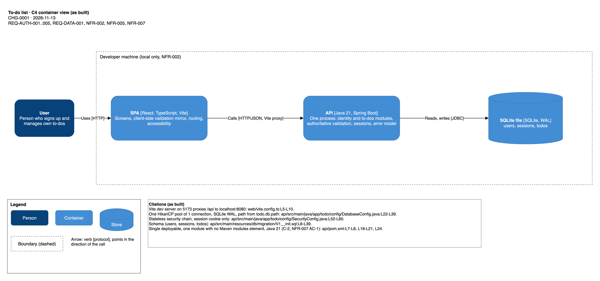
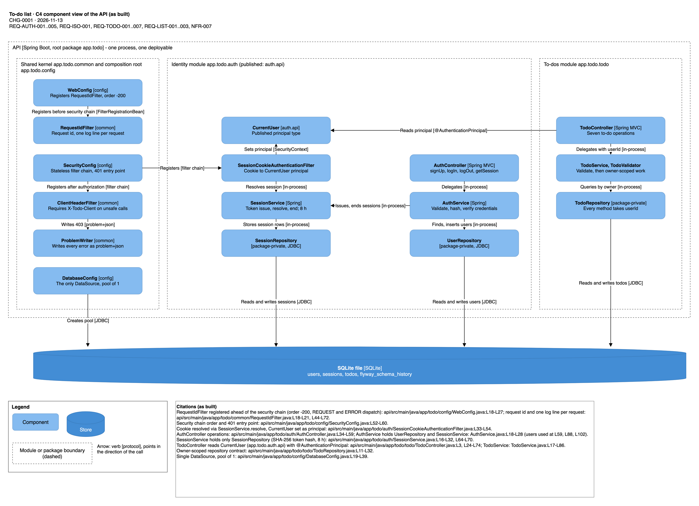
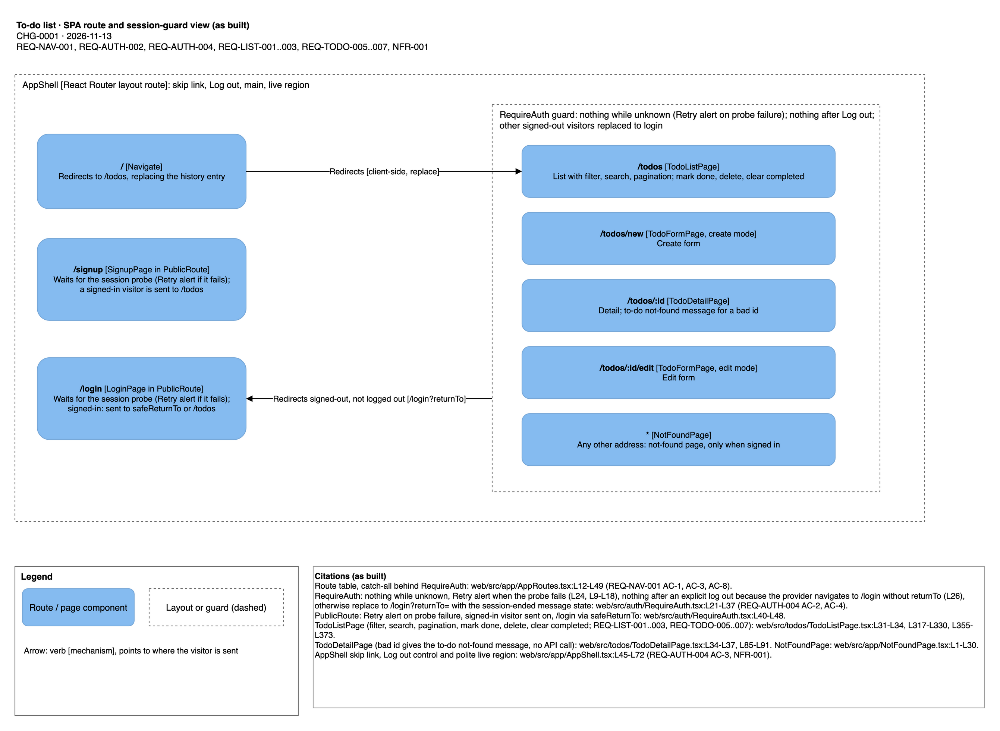
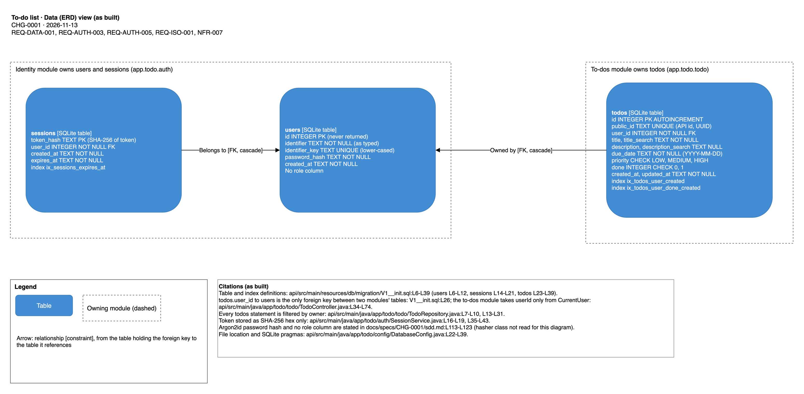

# To-do list system overview

The system lets a person sign up with one identifier (an email address or a username), log in, and create, edit,
complete, search, filter, page and delete their own to-dos. It runs only on the developer's machine (NFR-002) and
keeps its data in one SQLite file (REQ-DATA-001). Goals and scope: [requirements](../../specs/CHG-0001/requirements.md#context-and-goal).

## Containers

- **Web SPA**: React and TypeScript single-page app, see [components/web-spa.md](../components/web-spa.md).
- **API**: one Spring Boot 4 application (Java 21) split into modules, see [components/identity-module.md](../components/identity-module.md),
  [components/todos-module.md](../components/todos-module.md), [components/shared-kernel.md](../components/shared-kernel.md)
  and [components/composition-root.md](../components/composition-root.md).
- **Database**: SQLite file at `TODO_DB_PATH`, see [data/schema.md](../data/schema.md).

The browser reaches the API under `/api/v1/**` through the same origin (Vite proxy in development). No other process
or network service is used (NFR-002, [sdd.md section 2](../../specs/CHG-0001/sdd.md#2-components)).

## Diagrams

Embedded from `docs/knowledge/diagrams/` (drawn and reviewed under N15-docs-diagrams; the diagrams are not bundle
concepts, so the links below are plain files):

PDF exports: [containers](../diagrams/pdf/todo-containers.pdf), [API components](../diagrams/pdf/todo-api-components.pdf),
[SPA routes](../diagrams/pdf/todo-spa-routes.pdf), [data model](../diagrams/pdf/todo-data-model.pdf).

## Decisions

The eighteen accepted decisions are in [decisions/](../decisions/index.md) (ADR-0001 to ADR-0018). The module split
is [ADR-0018](../decisions/adr-0018-modular-monolith-module-boundaries.md).

## Requirements and tests

Requirement concepts are in [requirements/](../requirements/index.md) (27 entries: REQ-AUTH-001..005, REQ-ISO-001,
REQ-TODO-001..007, REQ-LIST-001..003, REQ-NAV-001, REQ-DATA-001..002, REQ-ACC-001, NFR-001..007). Test suites are in
[tests/](../tests/index.md). Business rules are in [rules/](../rules/index.md) and screens in [screens/](../screens/index.md).

## Known divergences (as recorded at N12 and N13)

- **[NFR-002](../requirements/nfr-002.md) AC-1 is deferred, not met.** `.env.example` and the README run steps that the frozen SDD section 11 requires
  are not present at HEAD; the runtime path (the Playwright main configuration starts the API and SPA with the documented
  commands) is evidenced. Source: `.harness/changes/CHG-0001/verdicts/N12-validate.validator.json` (finding F-14).
- **Firefox end-to-end runs did not launch on the build host**; the required Playwright projects are chromium and webkit
  (`.harness/config.yaml`, finding F-17 and F-9 in the same verdict).
- **Contract whitelist for `listTodos` `q`**: the frozen `todo-api-v1.yaml` rejects an empty or blank `q`, while SDD
  section 7 accepts it; the test-side whitelist in `api/src/test/java/app/todo/testsupport/Contracts.java` records the
  requester's decision (finding F-7). The API behaves as the SDD says.
- **Manual accessibility review not recorded (open gap).** SDD section 14 calls for a manual screen-reader and contrast pass on eight
  screens, and REQ-NAV-001 AC-6 for a flash review; neither is in the change's evidence ([NFR-001](../requirements/nfr-001.md)).
- **Request log shape.** The per-request line carries method, route, status and duration inside the message text, not as separate
  structured fields, a partial departure from SDD section 10 (`api/src/main/java/app/todo/common/RequestIdFilter.java:L79-L81`;
  N13 critic verdict F-2; see [shared kernel](../components/shared-kernel.md#logging-rules)).
- **Node version.** `web/.nvmrc` holds `lts/*`, not a pinned LTS, against SDD section 11 (N12 verdict F-2).
- **JDK.** The build compiles with JDK 23.0.2 using `--release 21`, against SDD section 11 (N12 verdict F-9; N13 critic verdict F-8).
  Both N12 items are in `.harness/changes/CHG-0001/verdicts/N12-validate.validator.json`.

## Glossary

- **Identifier**: the single login value, an email address or a username (REQ-AUTH-001 AC-7).
- **Active / Completed**: a to-do that is not done / done (REQ-TODO-005).
- **Filter**: All, Active or Completed (REQ-LIST-001).
- **Page**: up to 20 to-dos (REQ-LIST-003).
- **Shared kernel**: the `common` package, which every module uses and which uses no module ([shared-kernel](../components/shared-kernel.md)).
